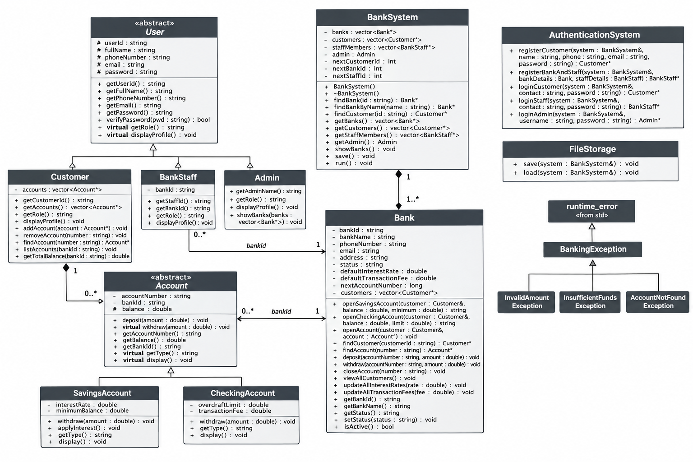

# DEU Bank System

A C++17 console-based banking system developed for an Object-Oriented Programming II project. It supports multiple banks, three user roles, and savings and checking accounts.

## UML Class Diagram



## Features

- **Customer:** Register once, log in, choose an approved bank, open savings/checking accounts, view accounts, deposit, and withdraw.
- **Bank Staff:** Register a bank and staff account, then manage customers and bank settings after admin approval. Staff can change interest rates and transaction fees and close eligible zero-balance accounts.
- **Admin:** View banks, customers, and staff; approve or reject bank registrations; review system statistics; and deactivate banks.
- **Accounts:** Savings accounts enforce a minimum balance. Checking accounts support overdrafts and transaction fees.
- **Persistence:** Banking data is saved to and loaded from text files.

New banks start with **PENDING** status. Customers can hold accounts at multiple approved banks without registering again.

## Project Structure

```text
include/    C++ class declarations (.h)
src/        Implementations, menus, and main.cpp
           User, AuthenticationSystem, Menus, BankSystem,
           Bank, Customer, Account, FileStorage, and related classes
data/       Saved text files (created/updated at runtime)
docs/       UML diagrams and project documentation
uml.mmd     Editable Mermaid class diagram
README.md   Project overview
```

## OOP Design

- `User` is an abstract base class inherited by `Customer`, `BankStaff`, and `Admin`. Each role implements `getRole()` and `displayProfile()`.
- `AuthenticationSystem` handles registration and login.
- `BankSystem` owns and coordinates banks, customers, and staff.
- `Bank` performs bank-specific account operations and keeps non-owning pointers to its customers.
- `Customer` owns its account objects.
- Abstract `Account` is inherited by `SavingsAccount` and `CheckingAccount`, which override virtual methods.
- `Menus` contains the command-line menu functions; `FileStorage` handles saving and loading.
- Custom exceptions handle invalid amounts, insufficient funds, and missing accounts.

## Build and Run

Requires a C++17 compiler. Run these commands from the project root:

**macOS / Linux**

```bash
g++ -std=c++17 -Wall -Wextra -Iinclude src/*.cpp -o bank_app
./bank_app
```

**Windows (MinGW)**

```bash
g++ -std=c++17 -Wall -Wextra -Iinclude src/*.cpp -o bank_app.exe
./bank_app.exe
```

## Data Storage

`FileStorage` uses five files in the `data/` folder:

```text
banks.txt
customers.txt
accounts.txt
admins.txt
bank_staff.txt
```

These files are generated from application data and should not be committed with real personal information or passwords. The editable class diagram is in `uml.mmd`.

## Team Contributions

- **Mubina:** User hierarchy, AuthenticationSystem, menu implementation, and system architecture.
- **Mukhsinjon:** Account hierarchy, BankSystem, FileStorage, and system integration.
- **Asror:** Account operations, savings/checking account concepts, and UML presentation.
- **Mukhammad Ali:** Customer, Admin, and BankStaff class analysis, user roles, and UML presentation.

> **Note:** This is a university demonstration project, not production banking software.
